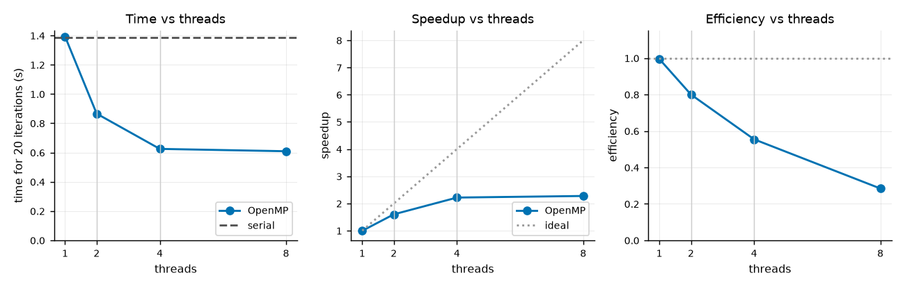
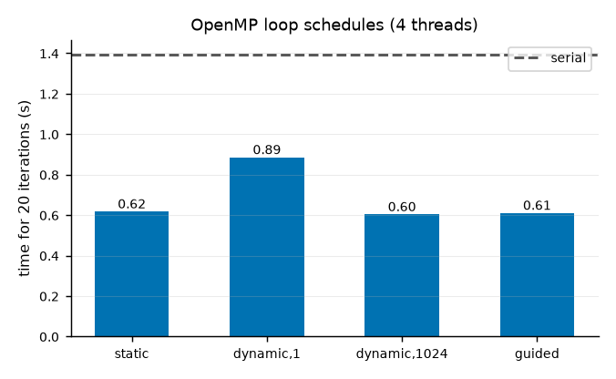
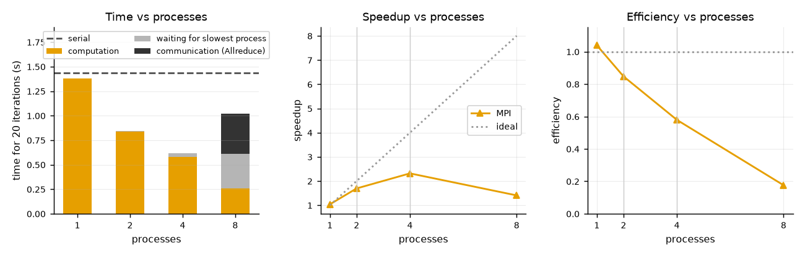
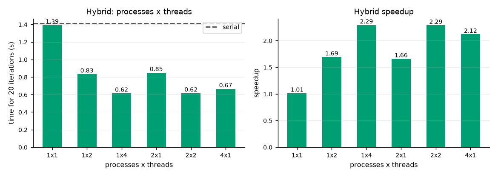
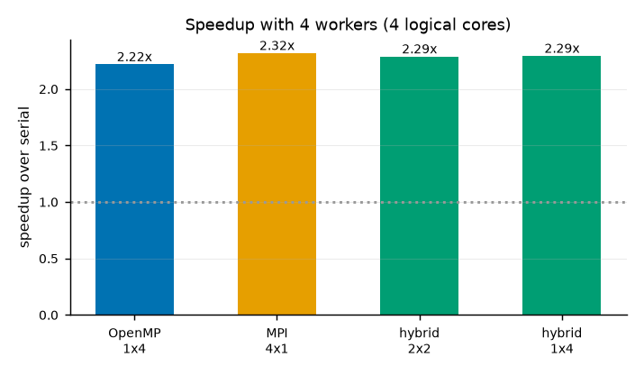
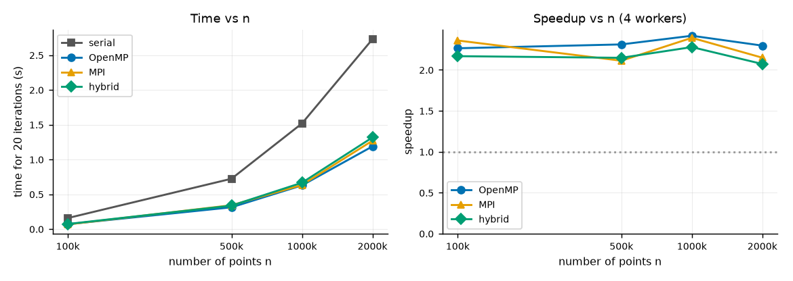
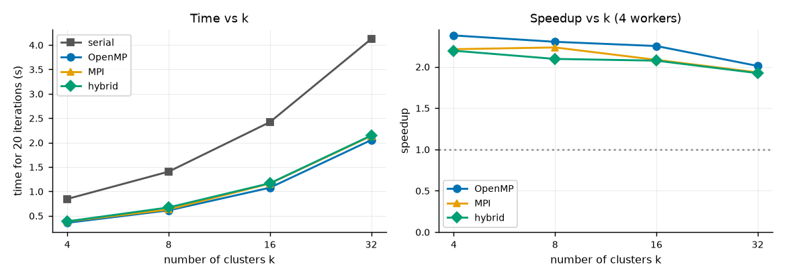
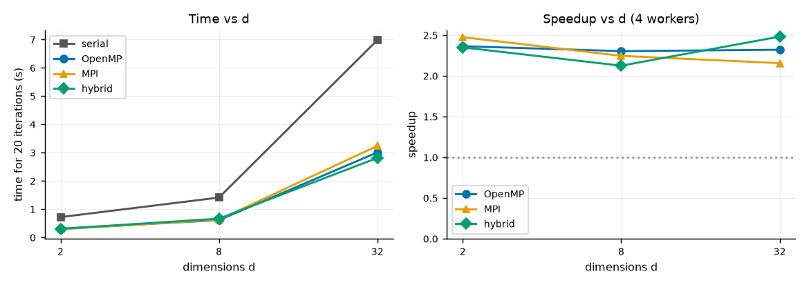
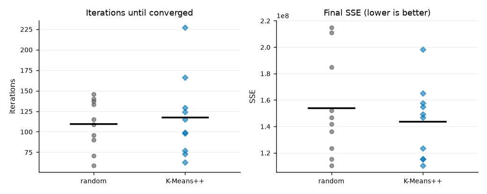

# Results and Analysis (draft)

All numbers below come from `results/*.csv` and are reproduced in `results/tables.md`; the figures are in `plots/`.
Abbreviations: MPI = Message Passing Interface, OpenMP = Open Multi-Processing, SSE = sum of squared errors.

## 1. Experimental setup

| Item | Value |
|---|---|
| Machine | Intel Core i7-6600U laptop, **2 physical cores / 4 hardware threads** (hyper-threading), 7.9 GB RAM |
| Software | Windows 10, GCC 16.2 (`-O2`), Microsoft MPI, OpenMP from GCC (libgomp) |
| Base problem | n = 1,000,000 points, d = 8 dimensions, k = 8 clusters (synthetic Gaussian blobs) |
| Work per run | exactly 20 iterations (`-m 20 -t -1`), so every version does identical work |
| Timing | wall-clock time of the iteration loop only (file reading and choosing starting centroids excluded) |
| Statistics | median of 5 runs; the repeats of all configurations in one experiment are interleaved (see 6.1) |
| Speedup, efficiency | S = T_serial / T_parallel; E = S / (processes x threads). T_serial is the serial program on the same data. |

Because the laptop has only 2 physical cores, the realistic upper limit for speedup is about 2x from the cores, plus
whatever hyper-threading adds (typically 20 to 30% for compute-heavy code), so roughly 2.4 to 2.6x. This is the frame
for reading every result below.

## 2. Correctness

`scripts/validate.py` compares every parallel version with the serial version on the synthetic data and on three
UCI datasets (Iris 150x4 with k=3, Wine 178x13 with k=3, Letter Recognition 20000x16 with k=26). Cases:
OpenMP with 1, 3 and 4 threads and static, dynamic and guided schedules; MPI with 1, 3 and 4 processes (3 does not divide
n evenly); hybrid 2x2 and 3x2. In all 36 comparisons the iteration count and the cluster sizes were identical,
and the centroids and SSE agreed to a relative difference below 1e-14 (the tiny difference comes from adding the
partial sums in a different order). Serial purity on the real data (share of points in the majority class of their
cluster): Iris 0.893, Wine 0.966, Letter 0.280 (K-Means is unsupervised, and 26 letter classes overlap heavily in
this feature space, so low purity there is expected).

## 3. OpenMP

| Threads | Time (s) | Speedup | Efficiency |
|---|---|---|---|
| 1 | 1.393 | 1.00 | 1.00 |
| 2 | 0.866 | 1.60 | 0.80 |
| 4 | 0.625 | 2.22 | 0.55 |
| 8 | 0.609 | 2.28 | 0.28 |

* One OpenMP thread costs the same as the serial program (speedup 1.00), so the OpenMP bookkeeping (private
  accumulators, merge) is negligible.
* Speedup grows to 2.2x at 4 threads and then **stops**: 8 threads on 4 hardware threads give no further gain
  (2.28x), and efficiency halves. There is nothing left to use, which is the expected behaviour and not a bug.
* The step from 1 to 2 threads gives 1.6x (efficiency 0.80), less than the ideal 2x even though there are 2 physical
  cores. Possible causes (not separately measured): the laptop CPU lowers its clock speed when more cores are busy,
  and the operating system may place two threads on the two hyper-threads of one core. The step from 2 to 4 threads
  adds about 40% more speed, consistent with hyper-threading giving a partial benefit.

**Scheduling policies (4 threads)**

| Schedule | Time (s) | Speedup |
|---|---|---|
| static | 0.618 | 2.26 |
| dynamic, chunk 1 | 0.886 | 1.57 |
| dynamic, chunk 1024 | 0.604 | 2.31 |
| guided | 0.611 | 2.28 |

Static, dynamic with a large chunk, and guided are indistinguishable (differences of 1 to 2% are inside the run-to-run
noise). Every point costs the same amount of work (k distance computations), so there is no load imbalance for dynamic
scheduling to repair. Dynamic with chunk 1 is clearly worse (about 45% slower than static) because threads must ask
the scheduler for work 1,000,000 times per iteration. Conclusion: for a loop with uniform iteration cost, static is
best (no scheduling overhead); dynamic would only pay off for uneven work.

## 4. MPI

| Processes | Time (s) | Waiting for slowest (s) | Allreduce (s) | Speedup | Efficiency |
|---|---|---|---|---|---|
| 1 | 1.381 | 0.000 | 0.0001 | 1.04 | 1.04 |
| 2 | 0.847 | 0.009 | 0.0008 | 1.69 | 0.85 |
| 4 | 0.619 | 0.039 | 0.0013 | 2.32 | 0.58 |
| 8 | 1.020 | 0.353 | 0.4089 | 1.41 | 0.18 |

* Up to 4 processes MPI behaves like OpenMP (2.32x at 4). The 1.04 at one process is measurement noise (a few percent),
  not a real gain.
* **Communication overhead is tiny while the processes have their own hardware thread.** Each iteration exchanges only
  k·d + 1 = 65 doubles and k counts. The measured `MPI_Allreduce` time is about 1 ms in total over 20 iterations
  for 4 processes (0.2% of the run). Waiting for the slowest process (load imbalance plus operating-system scheduling)
  is larger, 39 ms (6%).
* **At 8 processes the program gets slower than at 4 (speedup 1.41 vs 2.32).** There are only 4 hardware threads, so
  8 processes compete for them. About 75% of the time is then spent waiting (0.35 s) or inside `MPI_Allreduce` (0.41 s),
  because a process that needs its partner's data must wait until the operating system schedules that partner. The
  Allreduce time in this case is mostly this waiting, not data transfer. (It is likely that MPI waits by polling and so
  also wastes processor time, which would make it worse, but this was not measured.) OpenMP with 8 threads only
  plateaued; MPI with 8 processes got worse. The difference is that threads that finish early simply idle, but
  processes must synchronise with each other in every iteration.

## 5. Hybrid MPI + OpenMP

| Processes x threads | Workers | Time (s) | Waiting (s) | Allreduce (s) | Speedup |
|---|---|---|---|---|---|
| 1x1 | 1 | 1.394 | 0.000 | 0.0001 | 1.01 |
| 1x2 | 2 | 0.834 | 0.000 | 0.0001 | 1.69 |
| 1x4 | 4 | 0.616 | 0.000 | 0.0001 | 2.29 |
| 2x1 | 2 | 0.851 | 0.009 | 0.0006 | 1.66 |
| 2x2 | 4 | 0.618 | 0.013 | 0.0003 | 2.29 |
| 4x1 | 4 | 0.667 | 0.027 | 0.0081 | 2.12 |

With the same number of workers the three splits are within 8% of each other: 1x4 and 2x2 tie (2.29x) and 4x1 (pure MPI
shape) is slightly slower (2.12x), where the waiting and Allreduce columns are largest. Fewer processes means less
synchronisation, which is the usual argument for the hybrid model. On one machine, however, the gain is small, because
threads and processes both share the same 2 cores and the same memory. The expected real benefit of hybrid, fewer MPI
processes (less message traffic and less duplicated memory) when running across many nodes, cannot be shown on a single
laptop. Differences of a few percent here are close to the run-to-run noise (section 6.1), so they should not be
over-interpreted.

## 6. Effect of n, k and d

| n | serial (s) | OpenMP 4 | MPI 4 | hybrid 2x2 |
|---|---|---|---|---|
| 100,000 | 0.158 | 2.26x | 2.36x | 2.17x |
| 500,000 | 0.723 | 2.31x | 2.11x | 2.15x |
| 1,000,000 | 1.518 | 2.42x | 2.39x | 2.28x |
| 2,000,000 | 2.728 | 2.30x | 2.15x | 2.07x |

| k | serial (s) | OpenMP 4 | MPI 4 | hybrid 2x2 |
|---|---|---|---|---|
| 4 | 0.845 | 2.38x | 2.21x | 2.19x |
| 8 | 1.404 | 2.30x | 2.23x | 2.09x |
| 16 | 2.420 | 2.25x | 2.08x | 2.07x |
| 32 | 4.124 | 2.01x | 1.93x | 1.92x |

| d | serial (s) | OpenMP 4 | MPI 4 | hybrid 2x2 |
|---|---|---|---|---|
| 2 | 0.718 | 2.36x | 2.47x | 2.35x |
| 8 | 1.409 | 2.30x | 2.24x | 2.12x |
| 32 | 6.979 | 2.32x | 2.16x | 2.48x |

* **Serial time grows linearly with n, k and d** (for example 0.158 s to 2.728 s from n = 100k to 2M; 0.845 s to 4.124 s
  from k = 4 to 32), as expected from the O(n·k·d·i) cost.
* **Speedup is nearly the same for every size** (about 2.1 to 2.4x for n, d and most k) at 4 workers. The parallel part
  is a fixed share of the work, and the communication and merge cost per iteration depend only on k·d, not on n.
  Even at n = 100,000 the speedup is still 2.2x, because one iteration then takes about 3.5 ms, much longer than the
  Allreduce.
* Speedup drops slowly as k grows (2.38x at k = 4 down to 2.01x at k = 32 for OpenMP). We did not measure why; a
  possible reason is that with many centroids the centroid table (k·d doubles) and the private per-thread copies compete
  for cache, but this is a hypothesis.
* For d = 32 the hybrid run beat MPI and was close to OpenMP, but since the three versions differ by only 5 to 15%
  here this should not be treated as a stable ranking.

## 7. Amdahl's law, communication and memory bandwidth

**Amdahl's law.** Speedup is limited by the part that cannot be parallelised: S(p) = 1 / (f + (1 − f)/p), where f is the
serial fraction. In this program the serial parts are the update step (O(k·d)), merging the per-thread copies (O(T·k·d))
and, in MPI, the Allreduce. They are tiny compared with the assignment step (O(n·k·d)), so the serial fraction of the
*code* is well below 1%, and Amdahl's law alone would allow close to p-fold speedup. The measured limit (about 2.3x)
therefore comes from the **hardware** (2 physical cores), not from the algorithm. If one computed f from the measured
speedup (1.6x at 2 threads gives f ≈ 0.25), it would wrongly suggest a large serial part; this is why we keep the code's
serial fraction and the machine's limits separate.

**Communication overhead.** The messages are very small (65 doubles + k counts per iteration) so communication cost is
negligible when each process has its own hardware thread (about 0.2% at 4 processes). It becomes visible only through
synchronisation delays when processes outnumber hardware threads (8 processes: 75% of the time lost). For a cluster
with many nodes, per-iteration latency would matter more, and the cost would grow with k·d, not with n.

**Memory bandwidth.** The assignment step streams the full data set each iteration: 1,000,000 x 8 x 8 bytes = 64 MB,
or 1.28 GB over 20 iterations. At the best time (0.6 s) that is about 2 GB/s, which is far below what laptop memory
normally delivers (typically tens of GB/s; we did not measure this machine's bandwidth). So at k = 8 this
program is more likely limited by compute than by memory bandwidth. Memory bandwidth would become the limit for small
k and small d (little arithmetic per byte read), and for many more cores than this machine has. We did not run a
dedicated bandwidth test, so this conclusion is based on this estimate only.

## 8. Random vs K-Means++ initialisation (optional experiment)

Setup: serial, n = 200,000, d = 8, k = 16, clusters overlapping (std 8), 10 seeds, stop when the largest centroid move²
is below 1e-4.

| Start | Mean iterations | Mean SSE | Best SSE | Worst SSE |
|---|---|---|---|---|
| random | 109.6 | 1.537e8 | 1.105e8 | 2.148e8 |
| K-Means++ | 117.1 | 1.437e8 | 1.105e8 | 1.983e8 |

K-Means++ gave a slightly better average final SSE (about 7% lower) and a better worst case, but it did **not** reduce
the number of iterations here (117 vs 110). With only 10 seeds and this much seed-to-seed variation, the difference is
not statistically convincing; the main visible benefit is fewer bad local minima. K-Means++ costs extra
work before the loop (k passes over the data), which is not included in the timings; it was implemented in the serial
program only, since its cost and effect do not depend on the parallel version.

## 9. Repeat on Linux with Open MPI

The proposal names Linux with MPICH or Open MPI, so the whole project was rebuilt and rerun unchanged (only the
launcher flags below were added) on **Ubuntu 26.04 under WSL2 (Windows Subsystem for Linux) with GCC 15.2 and Open MPI**.
The WSL2 virtual machine sees the same 4 hardware threads but only 3 GB of RAM. Results are in `linux/results/` and
`linux/plots/`. For Open MPI the launcher needs `--oversubscribe` (more processes than CPU slots, for the 8-process test)
and `--bind-to none` (otherwise Open MPI pins a process to one core and its OpenMP threads cannot spread out).
`scripts/runlib.py` adds both automatically when Open MPI is detected.

* **Correctness:** all 36 comparisons with the serial version pass again, with the same iteration counts, cluster sizes
  and purity values as on Windows (Iris 0.893, Wine 0.966, Letter 0.280). The K-Means++ experiment gave exactly the same
  numbers on both systems (the random generator is our own, so the choice of starting centroids is identical).

| 4 workers unless stated, base problem | Windows (MS-MPI) | Linux/WSL2 (Open MPI) |
|---|---|---|
| serial time (s) | 1.39 | 1.60 |
| OpenMP 1 / 2 / 4 / 8 threads, speedup | 1.00 / 1.60 / 2.22 / 2.28 | 0.99 / 1.65 / 2.22 / 2.21 |
| MPI 1 / 2 / 4 / 8 processes, speedup | 1.04 / 1.69 / 2.32 / 1.41 | 1.02 / 1.73 / 1.95 / 2.05 |
| MPI 4 processes: waiting + Allreduce (s) | 0.039 + 0.0013 | 0.097 + 0.022 |
| MPI 8 processes: waiting + Allreduce (s) | 0.353 + 0.409 | 0.182 + 0.089 |
| hybrid 1x4 / 2x2 / 4x1, speedup | 2.29 / 2.29 / 2.12 | 2.16 / 2.20 / 2.10 |

* **OpenMP behaves the same on both systems** (2.22x at 4 threads, no gain at 8), which supports the conclusion that the
  limit comes from the 2-core hardware and not from the operating system.
* **MPI differs between the two MPI libraries.** With Open MPI, 4 processes are slower than on Windows (1.95x vs 2.32x:
  more waiting and a larger Allreduce time) but 8 processes still gain slightly (2.05x), while MS-MPI got much worse at 8
  (1.41x). So the oversubscription collapse seen on Windows is not a property of the algorithm but of how that MPI library
  waits when processes outnumber hardware threads. A likely reason is that Open MPI makes waiting processes give up the CPU
  when it detects oversubscription, but we did not test this. The slower 4-process result on Linux may come from Open
  MPI's shared-memory communication or the virtual machine; also untested.
* **Absolute times are about 15% slower on Linux** (serial 1.60 s vs 1.39 s), which is plausible for WSL2 (virtual
  machine overhead, different compiler version), so compare speedups between the two systems, not seconds.
* **Schedules:** in the main Linux run static looked slower than dynamic (0.80 s vs 0.68 s), but six alternating repeats
  gave 0.69 to 0.78 s for static, dynamic with chunk 1024 and guided alike, so this was noise, and the Windows conclusion
  (all three are equal for uniform work) stands. The same noise explains the odd d = 2 OpenMP result (1.75x while MPI
  and hybrid gave 2.3x on identical work).

## 10. Limitations and honest notes

1. **Noise.** On this laptop repeated runs of the same configuration vary by up to roughly 10 to 15%
   (heat, background programs). Early in the project the first benchmark gave a hybrid 1x1 speedup of 0.88 (slower than
   serial) and a 3.0x speedup at n = 100k. Both were measurement artefacts: re-running showed 1x1 hybrid equal to serial,
   and a fresh serial run at n = 100k took 0.15 s instead of the 0.22 s that had been measured, which inflated the speedup.
   We fixed this by interleaving the repeats of all configurations (every round runs serial, OpenMP, MPI and hybrid once)
   and using 5 repeats, so slow periods hit every configuration equally. Differences below about 5 to 8% in the tables
   should be treated as ties.
2. **One machine, 2 physical cores.** Scalability beyond 4 workers, real network communication and multi-node
   behaviour could not be measured. 8-worker results show oversubscription behaviour, not scalability.
3. **Two environments, both on the same laptop:** native Windows with Microsoft MPI (main results) and Ubuntu under
   WSL2 with Open MPI (section 9). Neither is a bare-metal Linux install, and absolute timings and MPI waiting behaviour
   differ between them.
4. Explanations marked "possible", "likely" or "hypothesis" were not tested individually.
